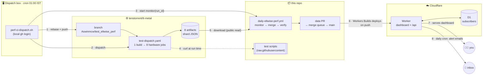

# TTNN Eltwise Performance Tracker

[](https://github.com/Aswincloud/ttnn-performance-dashboard/actions/workflows/ci.yml)
[](https://github.com/Aswincloud/ttnn-performance-dashboard/actions/workflows/daily-eltwise-perf.yml)
[](https://ttnn-eltwise-performance.aswincloud.com)
[](LICENSE)

**Did any TTNN eltwise op on Tenstorrent hardware get slower last night?** This repo answers that every morning.

Every night, about 290 eltwise ops (`add`, `exp`, `relu`, `div`, `gelu_bw`, …) are timed on real Tenstorrent cards, using the device-kernel time from tt-metal's profiler. The results land here as a pull request and show up on the dashboard:

### → [ttnn-eltwise-performance.aswincloud.com](https://ttnn-eltwise-performance.aswincloud.com)

| | |
|---|---|
| **Boards** | Wormhole **N150** · Blackhole **P100a** |
| **Dtypes** | bfloat16 · float32 |
| **Shapes** | `[1,1,32,32]` · `[1,1,256,256]` |
| **Combos** | 8 (every board × dtype × shape), one test job each |
| **Ops** | 296 tests per combo |
| **Cadence** | nightly, 01:00 IST; data lands within the hour |
| **History** | daily since July 2026 |

📖 The story behind it, including everything that broke: **[Benchmarking Tenstorrent hardware every night from a repo that owns none of it](https://blog.aswincloud.com/posts/daily-ttnn-perf-monitoring/)**

---

## How it fits together

This repo owns **no hardware**, and since PATs were banned on tenstorrent repos it holds **no credential that can write to tt-metal**. So the pipeline is split by privilege across four places:



| Step | Who | Credential |
|---|---|---|
| **1–3** Rebase the branch onto tt-metal `main`, dispatch the run, start our monitor | the dispatch box (`~/bin/perf-ci-dispatch.sh`) | the owner's local `gh` login, which never leaves the box |
| **4** Each hardware job `curl`s `test_eltwise_operations.py` and `perf_measurement_script.py` from this repo's `main` | tt-metal CI | none (public) |
| **5** Poll the run, download the artifacts, merge them, check provenance | `daily-eltwise-perf.yml`, `mode=monitor` | this repo's `github.token`: reads of a public repo only |
| **6** Open the data PR, approve it, land it through the merge queue | GitHub App + bot reviewer | `APP_ID`/`APP_PRIVATE_KEY`, `WRITE_ACCESS_PAT` |
| **7** Serve the SPA and the JSON | Cloudflare Worker (static assets) | none |
| **8** Email subscribers whose thresholds were crossed | Worker `scheduled` + D1 + Resend | Worker secrets |

At 05:00 IST a read-only **freshness check** (`mode=freshness`) requires every combo to have a result from the last 24 h. If any combo is missing, it opens an issue and posts to Slack. Details: [`.github/workflows/README.md`](.github/workflows/README.md).

### Why each result can be trusted

- **One build, eight jobs.** tt-metal is compiled once. The board, dtype and shape reach each job only through `ARCH_NAME`, `PERF_DTYPE` and `PERF_SHAPE`.
- **Provenance is checked, not assumed.** Every result records the `perf_arch`, `perf_dtype` and `perf_shape` it actually measured. The ingest step refuses the whole day if those don't match the folder the file is going into, so a mislabelled number can't land.
- **One device session per job.** `--in-process` runs the whole suite in one pytest session and reads kernel time straight from `ttnn.ReadDeviceProfiler`. A combo takes about 1–5 minutes; a whole run takes about 20 minutes, including queueing for runners.
- **Flakes don't erase timings.** If an op ran on the device and only its correctness check failed (random inputs, say), the timing is kept and the test is flagged in `correctness_check_failures`.

---

## Data

Everything is plain JSON in this repo, so you can read it without credentials:

```
data/workflow/<dtype>/<shape>/<date>_…_final.json          # N150 (no board prefix)
data/workflow/p100a/<dtype>/<shape>/<date>_…_final.json    # P100a
data/workflow/index.json                                   # per-combo file list
data/latest/latest_<combo>.json                            # newest result per combo
```

`<combo>` is `[p100a_]<bf16|fp32>_<32x32|256x256>`, for example `bf16_32x32` or `p100a_fp32_256x256`. With no board prefix, the combo is N150.

```bash
# last night's N150 bf16 32x32 numbers, no clone needed
curl -s https://raw.githubusercontent.com/Aswincloud/ttnn-performance-dashboard/main/data/latest/latest_bf16_32x32.json \
  | python3 -c "import json,sys; [print(f\"{r['operation_name']:24} {r['average_duration_ns']:>10.0f} ns\") for r in json.load(sys.stdin)['results']]"
```

Each result row has `average_duration_ns`, `std_deviation_ns`, `min_duration_ns`, `max_duration_ns` and `successful_runs`. `metadata` records `git_commit_id`, the tt-metal commit that was actually built and measured.

---

## Running a sweep yourself

You need push access to `tenstorrent/tt-metal`. The blog post has a [complete copy-paste script](https://blog.aswincloud.com/posts/daily-ttnn-perf-monitoring/#run-it-yourself). It works on **your own** branch, copied from `Aswinmcw/test_eltwise_perf`. Never dispatch on that branch or push to it: the nightly job force-pushes it.

To measure on a machine with a card instead:

```bash
cd ~/tt-metal && source python_env/bin/activate
cp /path/to/this/repo/{test_eltwise_operations,perf_measurement_script}.py .
PERF_DTYPE=bf16 PERF_SHAPE=1,1,32,32 python perf_measurement_script.py --in-process
# just a few ops:
python perf_measurement_script.py --in-process --tests test_exp test_add
```

Run it from the tt-metal root, which has the `pytest.ini` the harness relies on to collect tests.

---

## The dashboard

- **Compare** any of the 8 combos side by side, with one sub-row per combo under each op.
- **Latest day** strip: regressions and improvements of at least 5% against the previous day.
- **Table / Charts**, unit switch (ns/µs/ms/s), category filter, search, date range, CSV export.
- **Get Alerts**: subscribe with your own improvement and degradation thresholds, confirmed by double opt-in. See [docs/PERFORMANCE_ALERTS.md](docs/PERFORMANCE_ALERTS.md).

### Develop

```bash
npm install
npm run dev            # http://localhost:3000
npm run lint && npm run build
npx playwright test    # smoke E2E against `vite preview`
```

Node 20 (`.nvmrc`). Built with React 19, Vite, Tailwind and Recharts. It's served by a Cloudflare Worker (`wrangler.toml`) that also hosts `/api/*` for alerts. Cloudflare Workers Builds deploys every push to `main`.

### Layout

```
src/                       React app (App.jsx, components/, utils/dataLoader.js)
worker/                    Cloudflare Worker: static assets + alert API + daily cron
migrations/                D1 schema for subscribers
test_eltwise_operations.py the op suite (one pytest per op)
perf_measurement_script.py harness: --in-process timing, --shard, --merge, provenance stamp
generate_workflow_index.py builds data/workflow/index.json + data/latest/*
combine_to_csv.py          turn downloaded tt-metal artifacts into per-combo CSVs
.github/workflows/         daily-eltwise-perf (monitor/recover/freshness), CI, auto-approve
```

### Adding a combo

The combo key is the contract between the two repos. To add one:
1. Add the matrix cell on the tt-metal branch. The artifact is named `eltwise-perf-results-[<board>-]<dtype>-<shape>-shard-<i>`.
2. Add the key to `COMBOS` in `daily-eltwise-perf.yml`, `generate_workflow_index.py`, `combine_to_csv.py` and `src/App.jsx`.

New cells: push tt-metal first. New harness behaviour: merge here first. Either way, a mismatch fails loudly (`artifact-missing` or `combo-provenance-mismatch`) instead of landing wrong data.

---

## License

MIT. See [LICENSE](LICENSE). Built on [tt-metal](https://github.com/tenstorrent/tt-metal); thanks to the Tenstorrent team.
